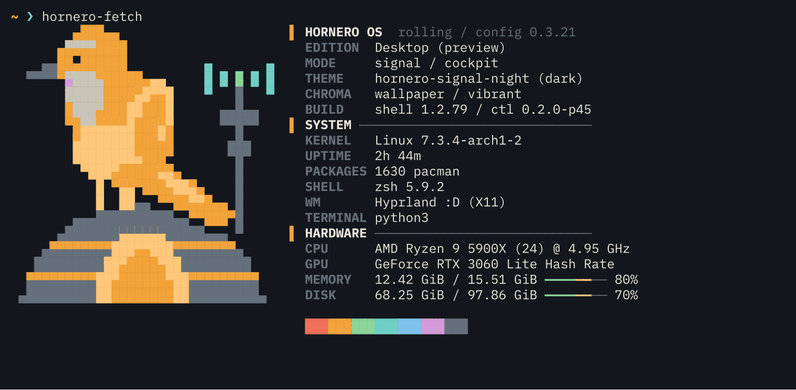
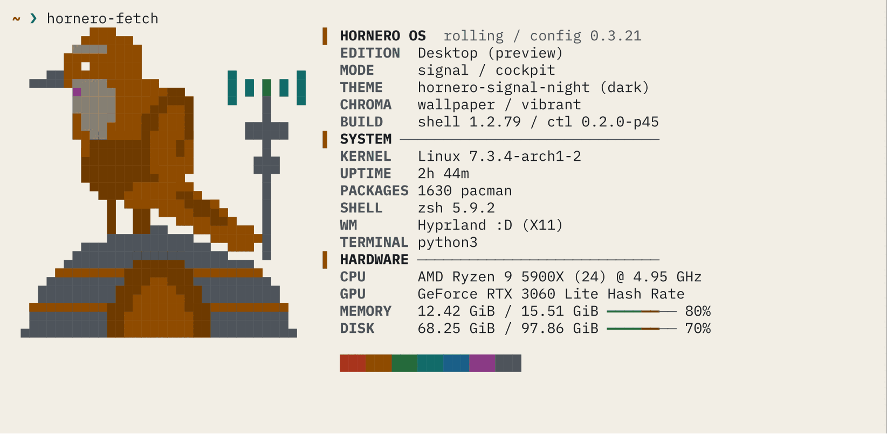
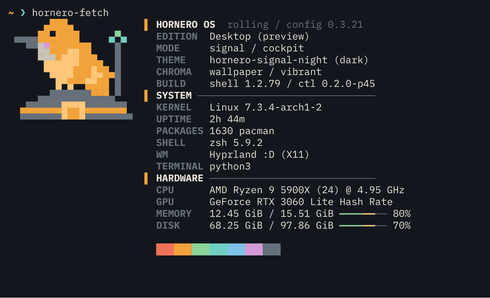

# The HorneroOS fastfetch card

`fastfetch` (bare) shows the HorneroOS card: an original rufous hornero on its
clay-oven nest, then a short, aligned set of rows. It follows Signal Bezel
Calido: slate labels, one amber tick per section, values in the default ink,
everything coloured with terminal palette **roles**, never RGB.

```
 [hornero]   ▌ HORNERO OS  rolling / config 0.3.21
             EDITION  Desktop
             MODE     signal / cockpit
             THEME    hornero-signal-night (dark)
             CHROMA   wallpaper / vibrant
             BUILD    shell 1.2.79 / ctl 0.2.0-p45
             ▌ SYSTEM ──────────────────────
             KERNEL · UPTIME · PACKAGES · SHELL · WM · TERMINAL · FONT
             ▌ HARDWARE ────────────────────
             CPU · GPU · MEMORY ━━━━── 80% · DISK ━━━━── 70% · BATTERY
             ███████  <- the terminal's live palette
```

Captures (headless: real fastfetch output replayed through a small terminal
renderer with the shipped Signal palettes; not screenshots of a GUI terminal):





## Files

| File | Role |
|---|---|
| `desktop/fastfetch/config.jsonc` | Stock fastfetch config (installed to `~/.config/fastfetch/`). |
| `desktop/fastfetch/hornero.txt`, `hornero-mini.txt` | Generated ANSI logos (34x18 and 20x9 cells). Do not edit. |
| `desktop/fastfetch/art/*.pix` | Logo **source**: one character per pixel, legend of palette roles. Edit these. |
| `desktop/fastfetch/art/hornero-nest.svg` | Generated crisp SVG of the full art (image logo source). |
| `scripts/gen-fastfetch-logo.py` | Regenerates the three generated files; `--check` is run by the test. |
| `bin/hornero-fetch` | Front door: terminal-aware logo choice, override file, HorneroOS facts. |

After editing a `.pix`, run `scripts/gen-fastfetch-logo.py` and commit the
generated files together with it.

## Colour: why it follows your theme

The logo and the rows only use ANSI roles: `33` amber (plumage, section tick),
`93` bright amber (belly, lamp), `37` pale (throat), `90` slate (nest stone,
labels, rules), `36` cyan, `32` green, `35` rose, `31` alert. The terminal
palette is what Signal themes and Hornero Chromatic rewrite, so the bird is
repainted by Night, Day, Dusk, Contrast and by wallpaper-derived palettes with
no extra work. The strip at the bottom is the live palette: when Chromatic is
active it *is* the wallpaper-derived colours. Anatomy never recolours; only the
role values change.

## Logo selection (`hornero-fetch`)

| Terminal width | `--logo auto` |
|---|---|
| >= 90 columns | full ANSI art |
| 60 to 89 | compact ANSI art |
| < 60 | no logo, percentages instead of meters |
| output is a pipe or file | no art (plain rows) |

`--logo image` draws a PNG with the kitty graphics protocol in kitty, ghostty
and wezterm (`TERM=xterm-kitty`, `TERM_PROGRAM=ghostty|WezTerm`). Terminals
without a protocol (alacritty, plain xterm, tty) fall back to the ANSI art. By
default the PNG is rasterised once from `art/hornero-nest.svg` into
`$XDG_CACHE_HOME/hornero/fastfetch/` with `rsvg-convert`. Images carry fixed
Signal Night colours (an image has no terminal palette), which is why `auto`
never picks one.

## Customising

Precedence: command line, then environment, then the user file, then defaults.

`${XDG_CONFIG_HOME:-~/.config}/hornero/fastfetch.conf` (`key=value`, `#`
comments):

| Key | Env | Values |
|---|---|---|
| `logo` | `HORNERO_FETCH_LOGO` | `auto` (default), `ansi`, `mini`, `image`, `none` |
| `image` | `HORNERO_FETCH_IMAGE` | Path to any PNG/JPEG for `logo=image`. This is the hook for new mascot art: drop in the new Javi PNG, no code change. |
| `identity` | `HORNERO_FETCH_IDENTITY` | `1` shows a `user@host` row. Off by default. |
| `config` | `HORNERO_FETCH_CONFIG` | A different fastfetch config. |

Your own `~/.config/fastfetch/config.jsonc` is always used first, so you can
reorder or remove any row (the HorneroOS rows are ordinary `command` modules
calling `hornero-fetch fact <name>`: `edition mode theme chroma build release
banner identity`). `HORNERO_FETCH=0` makes a bare `fastfetch` run the stock
binary in zsh. `hornero-fetch --help` lists everything.

## Privacy and speed

No network call is made. Hostnames, IP addresses, Wi-Fi, DNS, users and the
wallpaper path are not in the default card (the test fails if a module that
exposes them is added, or if the hostname or an IPv4 address appears in the
output). Facts are read from local state files (`experience.json`,
`current-shell-preset`, `signal/scheme.json`, `chromatic/state.json`, the
pacman local database) in about 5 ms each; the whole card renders in well
under 150 ms on the maintainer's machine and is gated at 400 ms on CI.

## Validation

`tests/test_fastfetch.sh` (hermetic: fixtures in `tests/fixtures/fastfetch`,
recording fastfetch shim for logo selection): palette-role-only contract,
generated files in sync, facts, selection matrix, knobs, image fallback,
privacy, speed.
